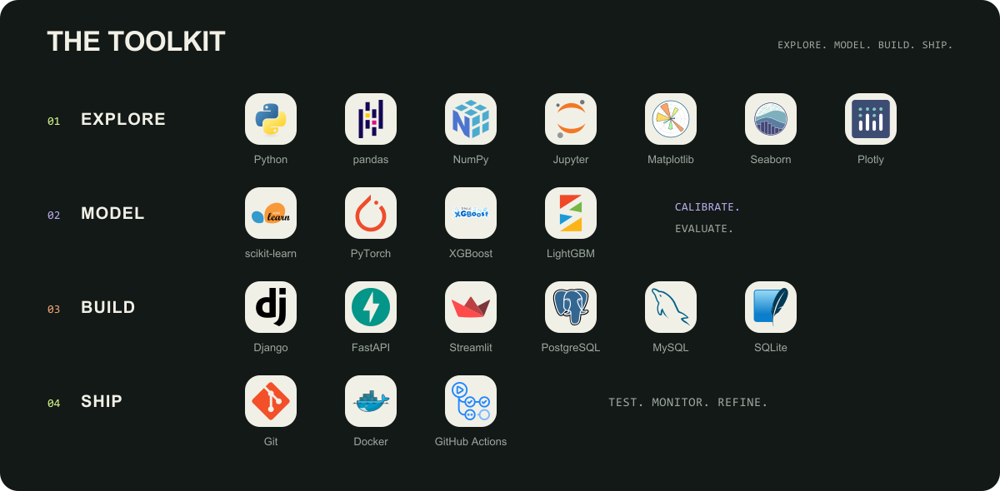
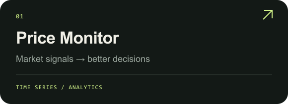
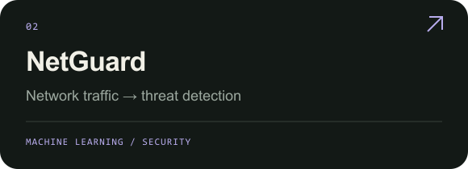
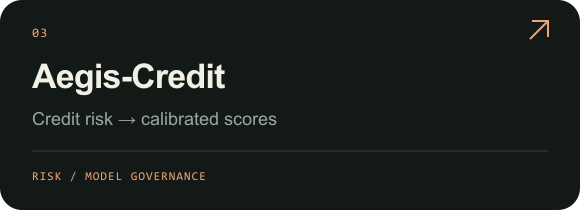
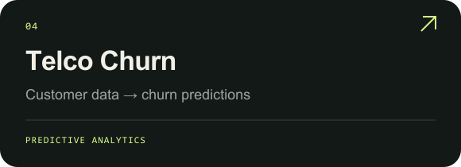

  

  <a href="https://khalidkarroum.github.io/"><b>Portfolio ↗</b></a> &nbsp; / &nbsp;
  <a href="https://www.linkedin.com/in/khalid-karroum/"><b>LinkedIn ↗</b></a> &nbsp; / &nbsp;
  <a href="mailto:karroumkhalid6@gmail.com"><b>Say hello ↗</b></a>

Master d’Excellence · Data Science & Information Systems Security · PFE internship: January 2027, 6 months

 

  

 

### SELECTED WORK ↘

  
  

  
  

<a href="https://github.com/KHALIDKARROUM/Marketplace">Puddle Marketplace ↗</a> &nbsp; · &nbsp; <a href="https://github.com/KHALIDKARROUM/Diabetes-Prediction-">Diabetes Prediction ↗</a> &nbsp; · &nbsp; <a href="https://github.com/KHALIDKARROUM?tab=repositories">All repositories ↗</a>

