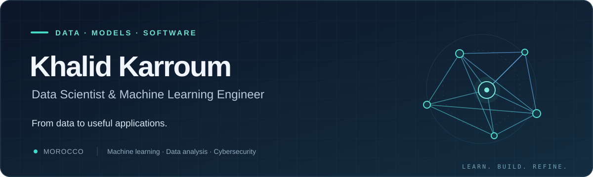

  

  
  
  

<b>Seeking a six-month PFE internship starting January 2027</b> Data Science · Machine Learning · Data Analytics · Data Engineering

## A little about me

I'm **Khalid**, a **Master d’Excellence student in Data Science & Information Systems Security** at **Université Sultan Moulay Slimane**, Morocco, with graduation expected in **2027**.

I work with data, train machine-learning models, and build applications around them. My projects connect exploratory analysis and model evaluation with APIs, dashboards, and reproducible workflows, with a particular interest in **financial data science, cybersecurity, and reliable ML systems**.

Since **September 2026**, I've been a **Python Developer & Data Analyst Intern at Delta Holding**, developing **Price Monitor** for market-data collection, analysis, forecasting, and purchasing preparation.

## Selected work

<table>
  <tr>
    <td width="50%" valign="top">
      <h3><a href="https://github.com/KHALIDKARROUM/prices_monitor">01 / Price Monitor</a></h3>
      
<b>Market data & time series</b>

      
Traceable energy-market data, forecasting workflows, price alerts, and a dashboard for purchasing preparation. Developed during my Delta Holding internship.

      
<code>Python</code> <code>pandas</code> <code>scikit-learn</code> <code>SQL</code>

    </td>
    <td width="50%" valign="top">
      <h3><a href="https://github.com/KHALIDKARROUM/NetGuard">02 / NetGuard</a></h3>
      
<b>Machine learning & cybersecurity</b>

      
Network-traffic analysis and model comparison on UNSW-NB15, with single and batch scoring through a FastAPI service and Streamlit dashboard.

      
<code>XGBoost</code> <code>LightGBM</code> <code>PyTorch</code> <code>FastAPI</code>

    </td>
  </tr>
  <tr>
    <td width="50%" valign="top">
      <h3><a href="https://github.com/KHALIDKARROUM/Aegis-Credit">03 / Aegis-Credit</a></h3>
      
<b>Credit-risk screening & model governance</b>

      
A portfolio demonstration connecting calibrated scoring, case review, batch workflows, monitoring, and controlled model delivery.

      
<code>scikit-learn</code> <code>Django</code> <code>PostgreSQL</code> <code>Docker</code>

    </td>
    <td width="50%" valign="top">
      <h3><a href="https://github.com/KHALIDKARROUM/customer-churn-prediction">04 / Telco Churn</a></h3>
      
<b>Predictive analytics & dashboards</b>

      
A reproducible churn-modeling pipeline with training-only model selection, calibrated scores, and a shared model layer for Django and Streamlit.

      
<code>Python</code> <code>scikit-learn</code> <code>Django</code> <code>Streamlit</code>

    </td>
  </tr>
</table>

**Also built:** [Puddle Marketplace](https://github.com/KHALIDKARROUM/Marketplace), a Django application with listings and private conversations, and [Diabetes Prediction](https://github.com/KHALIDKARROUM/Diabetes-Prediction-), an educational machine-learning notebook.

## Tools I use

| Area | Technologies & practices |
| :--- | :--- |
| **Data & analysis** | Python · SQL · pandas · NumPy · Jupyter |
| **Machine learning** | scikit-learn · XGBoost · LightGBM · PyTorch · Feature engineering · Calibration |
| **Visualization** | Matplotlib · Seaborn · Plotly · Streamlit |
| **Applications** | Django · FastAPI · REST APIs · PostgreSQL · MySQL · SQLite |
| **Delivery & reliability** | Git · Docker · Docker Compose · GitHub Actions · Testing · Drift monitoring |

## How I approach a project

- **Understand the data:** check sources, missing values, units, and the problem the model needs to solve.
- **Evaluate carefully:** keep preprocessing and model selection separate from final evaluation, and explain the limits of the results.
- **Make it usable:** connect the analysis to an application with clear inputs, practical workflows, and automated checks.

## Let's connect

I'm interested in internship opportunities and conversations about data science, machine learning, data engineering, and backend development.

**[LinkedIn](https://www.linkedin.com/in/khalid-karroum/)** · **[Email](mailto:karroumkhalid6@gmail.com)** · **[Browse my repositories](https://github.com/KHALIDKARROUM?tab=repositories)**

Curious about the data. Careful with the models. Focused on the application.

